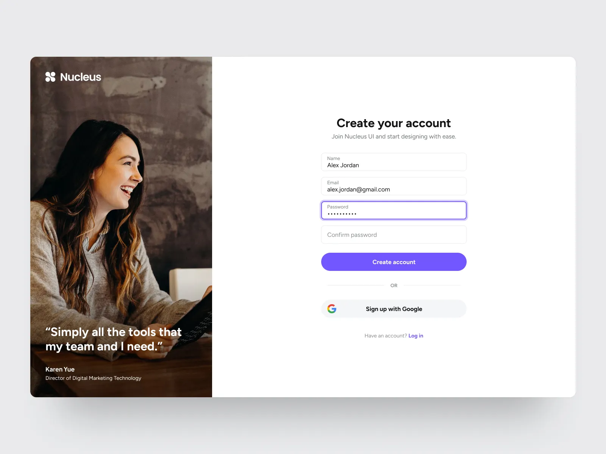

# 🚀 Reto Técnico Front-End — Dennky | Vue 3 + TypeScript

Solución desarrollada para el reto técnico Front-End de **Dennky**, consistente en la maquetación y validación de una interfaz de autenticación (**Creación de cuenta e Inicio de sesión**) basada fielmente en el diseño de referencia de **Nucleus UI**.

---

## 🎨 Diseño de Referencia

- **Diseño en Dribbble:** [Login / Register Page — Nucleus UI](https://dribbble.com/shots/25536172-Login-Register-Page-Nucleus-UI)
- **Imagen de referencia original:**
  
  

---

## 🛠️ Tecnologías Utilizadas

- **[Vue 3](https://vuejs.org/)** (v3.5+): Framework progresivo de interfaz reactiva.
- **[Composition API](https://vuejs.org/guide/extras/composition-api-faq.html)** con sintaxis `<script setup lang="ts">`.
- **[TypeScript](https://www.typescriptlang.org/)** (v5.9+ / v6+): Tipado estático estricto para componentes, interfaces de datos y validaciones.
- **[Vite](https://vitejs.dev/)** (v8+): Herramienta de bundling de última generación, ultrarrápida en desarrollo y optimizada para producción con Rollup.
- **HTML5 Semántico**: Uso riguroso de `<main>`, `<aside>`, `<header>`, `<footer>`, `<form>`, `<figure>`, `<blockquote>`, `<label>` y atributos accesibles ARIA (`aria-invalid`, `aria-describedby`, `role="alert"`, `role="dialog"`).
- **CSS3 Responsivo (Vanilla CSS & Scoped Styles)**: Sin dependencias externas de utilidades CSS pesadas; control milimétrico de tokens de diseño (variables CSS), espaciados, tipografía geométrica (*Plus Jakarta Sans* vía Google Fonts) y diseño fluido.

---

## 📋 Requisitos Previos

- **Node.js**: versión 18.x o superior (recomendado Node.js 20.x o 24.x LTS).
- **npm**: versión 9.x o superior.

---

## 💻 Instalación y Ejecución

### 1. Clonar el repositorio (si aún no se ha clonado)
```bash
git clone https://github.com/JerycoopV/prueba-dennky.git
cd prueba-dennky
```

### 2. Instalar dependencias
```bash
npm install
```

> **Nota para entornos Windows PowerShell:** Si las políticas de ejecución de scripts de Windows bloquean `npm.ps1`, ejecuta directamente con `npm.cmd install` o habilita la política mediante `Set-ExecutionPolicy -Scope Process -ExecutionPolicy Bypass`.

### 3. Iniciar el servidor de desarrollo
```bash
npm run dev
```
La aplicación estará disponible inmediatamente en `http://localhost:5173/` (o `http://127.0.0.1:5173/`).

### 4. Comprobación estricta de tipos TypeScript
```bash
npm run type-check
```

### 5. Compilar para producción
```bash
npm run build
```
Genera la versión optimizada en la carpeta `/dist`.

### 6. Previsualizar la versión de producción
```bash
npm run preview
```

---

## 🏛️ Arquitectura del Proyecto

```text
prueba-dennky/
├── public/
│   ├── favicon.svg             # Favicon vectorial con isotipo de Nucleus
│   └── hero-image.png          # Imagen de alta resolución del banner lateral
├── src/
│   ├── assets/
│   │   └── hero-image.png      # Recurso gráfico de la sección izquierda
│   ├── components/
│   │   ├── AuthInput.vue       # Input flotante estructurado (foco, error, revelar contraseña)
│   │   ├── FeedbackModal.vue   # Modal accesible de confirmación de validación Front-End
│   │   ├── HeroBanner.vue      # Columna lateral con testimonio de Karen Yue
│   │   ├── LoginForm.vue       # Formulario de inicio de sesión conmutativo
│   │   ├── NucleusLogo.vue     # Logotipo vectorial e isotipo de Nucleus UI
│   │   ├── RegisterForm.vue    # Formulario principal de registro replicado de Nucleus UI
│   │   └── ToastNotification.vue # Notificaciones flotantes para acciones secundarias
│   ├── composables/
│   │   └── useAuthValidation.ts # Lógica reactiva y reutilizable de validación de campos
│   ├── types/
│   │   └── auth.ts             # Interfaces TypeScript (RegisterFormData, LoginFormData, etc.)
│   ├── App.vue                 # Contenedor principal con tarjeta centrada y transiciones
│   ├── main.ts                 # Punto de entrada de la aplicación Vue
│   └── style.css               # Estilos globales, tokens de color y tipografía
├── index.html                  # Plantilla HTML con metadatos y fuente Plus Jakarta Sans
├── package.json                # Configuración de dependencias y scripts de ejecución
├── reference.png               # Imagen de referencia visual del reto
├── README.original.md          # Copia íntegra de las instrucciones originales del reto
├── tsconfig.json               # Configuración de TypeScript
└── vite.config.ts              # Configuración de Vite con plugin oficial de Vue
```

---

## 🔍 Resumen de la Implementación y Validaciones

### 1. Maquetación Fiel al Diseño
- **Estructura Split-Card:** Se replicó la proporción exacta de tarjeta (relación aproximada 1:2 entre banner y formulario) sobre fondo neutro suave (`#eaebed`), con esquinas redondeadas (`border-radius: 20px`) y sombras sutiles multinivel.
- **Inputs flotantes estructurados:** En Nucleus UI, cada campo agrupa una etiqueta pequeña superior (`font-size: 11.5px`) y el campo de texto inferior (`font-size: 14.5px`). Al recibir el foco, se aplica el borde violeta corporativo (`#6d56e6`) con anillo de resplandor (`box-shadow: 0 0 0 3.5px rgba(109, 86, 230, 0.14)`), tal como se ilustra en el campo *Password* de la referencia original.
- **Acción de visibilidad de contraseña:** Icono interactivo de ojo / ojo tachado accesible para inspeccionar la contraseña ingresada.
- **Botón de Google y Separador OR:** Botón secundario con fondo suave (`#f4f6f8`) y el logotipo oficial multicolor en SVG de Google.
- **Alternancia entre Registro e Inicio de Sesión:** Permite alternar fluidamente entre "Crear cuenta" e "Iniciar sesión", demostrando versatilidad en ambos flujos.

### 2. Reglas de Validación
- **Campos obligatorios:** Si se presiona el botón o la tecla *Enter* con campos vacíos, se activan mensajes explicativos en rojo bajo cada campo correspondiente.
- **Formato de correo electrónico:** Valida la estructura mediante expresión regular RFC compliant (`nombre@dominio.extensión`). Si el formato no coincide, se informa al usuario de inmediato.
- **Longitud y seguridad de contraseña:** Se exige un mínimo de 8 caracteres. Además, se previene el uso de secuencias triviales (`123`, `12345678`) y se valida que la contraseña no sea igual ni contenga el nombre de la cuenta.
- **Confirmación de contraseña:** Verifica que el valor coincida exactamente con la contraseña principal en tiempo real.
- **Validación de correos en sesión:** Si el usuario intenta registrar un correo que ya fue creado previamente en la sesión, se muestra una alerta específica indicando que el correo ya existe.
- **Validación en tiempo real y blur:** Si el usuario interactúa o sale de un campo (`@blur`), el error se evalúa inmediatamente y permanece activo mientras el valor no cumpla los requisitos, eliminándose en cuanto se introduce un valor válido.
- **Accesibilidad y navegación por teclado:**
  - Envío automático con la tecla *Enter*.
  - Enfoque programático (`.focus()`) en el primer campo inválido ante un intento de envío fallido.
  - Vinculación semántica con `<label for="...">`, `aria-invalid` y `aria-describedby` para lectores de pantalla.
- **Confirmación local ética y reinicio de formulario:**
  Al enviar datos válidos, se despliega un modal elegante (*FeedbackModal*) que confirma la superación de las validaciones locales. El modal incluye la opción **"Registrar otro usuario"**, la cual limpia y reinicia el formulario desde cero para evitar conflictos de estado entre creaciones sucesivas.

---

## 📱 Adaptaciones Responsivas

| Dispositivo / Resolución | Adaptación implementada |
| :--- | :--- |
| **Escritorio (> 960px)** | Tarjeta flotante centrada con banner testimonial a la izquierda (460px) y formulario a la derecha con márgenes equilibrados. |
| **Tablet (768px - 960px)** | Reducción proporcional del ancho del banner hero (340px) y ajuste de padding interno para mantener legibilidad sin desbordamiento. |
| **Móvil (< 768px)** | El contenedor pasa a ancho completo (100% viewport) sin bordes laterales sobrantes. El banner visual se oculta para priorizar la interacción táctil, apareciendo un encabezado superior con el logotipo corporativo *Nucleus*. Los campos y botones mantienen alturas táctiles cómodas (≥ 48px), sin scroll horizontal. |

---

## 🧩 Dificultades Encontradas y Soluciones

1. **Restricción de scripts en Windows PowerShell:**
   - *Problema:* Al ejecutar `npm` en la terminal de PowerShell en Windows, el sistema bloqueaba la ejecución de `npm.ps1` por la política de seguridad del entorno local (`PSSecurityException`).
   - *Solución:* Se utilizaron llamadas directas a `npm.cmd` y scripts nativos de Node.js para tareas de automatización de archivos, garantizando compatibilidad absoluta en cualquier terminal Windows (CMD, PowerShell o Git Bash).

2. **Inicialización sobre un repositorio existente sin perder Git:**
   - *Problema:* Las herramientas automáticas de scaffolding (`create-vite`) habitualmente requieren directorios vacíos o pueden sobrescribir archivos existentes de Git.
   - *Solución:* Se generó una plantilla temporal aislada y se trasladaron los ficheros de configuración (`package.json`, `tsconfig.json`, `vite.config.ts`, `src/`) a la raíz del repositorio preservando íntegramente la carpeta `.git`, la rama `main`, la configuración del remoto de GitHub y el archivo `README.md` original en `README.original.md`.

3. **Fidelidad cromática y de tipografía:**
   - *Problema:* Lograr los tonos exactos y las proporciones del shot de Dribbble sin contar con un archivo Figma abierto.
   - *Solución:* Se realizó un análisis pixel a pixel de la imagen original (`reference.png`), extrayendo las coordenadas de color exactas del botón primario (`#6d56e6`), el fondo de la tarjeta (`#ffffff`), el fondo del lienzo (`#eaebed`) y el botón social de Google (`#f4f6f8`), aplicando la tipografía *Plus Jakarta Sans* que coincide con el sistema de diseño Nucleus UI.

> 📝 **[Espacio reservado para reflexiones del postulante]:**
> *(Puedes complementar aquí cualquier aspecto particular de tu propia experiencia de desarrollo durante la realización del reto antes de entregar el enlace final).*

---

## 💡 Aprendizajes Obtenidos

- Profundización en la arquitectura por componentes y composables de **Vue 3 con Composition API** y tipado estricto con **TypeScript**.
- Implementación de patrones de validación reactiva en tiempo real (*real-time error clearance*) sin degradar la experiencia de usuario ni generar alertas prematuras antes de la interacción.
- Manejo avanzado de accesibilidad web (WCAG): etiquetado semántico, atributos `aria-*`, gestión del foco y soporte completo para teclado.

> 📝 **[Espacio reservado para aprendizajes adicionales del postulante]:**
> *(Puedes añadir aquí impresiones personales o lecciones aprendidas durante tu revisión).*

---

## 🚀 Mejoras Futuras Posibles

- **Integración con proveedor de autenticación real:** Conexión con Supabase Auth, Firebase Authentication o API REST backend mediante JWT.
- **Medidor dinámico de fuerza de contraseña:** Barra de progreso interactiva que evalúe entropía, mayúsculas, números y caracteres especiales.
- **Soporte para Modo Oscuro (Dark Theme):** Incorporación de un selector de tema claro/oscuro mediante variables CSS dinámicas.
- **Pruebas automatizadas:** Incorporación de tests unitarios y de componentes con [Vitest](https://vitest.dev/) y [@vue/test-utils](https://test-utils.vuejs.org/), además de pruebas end-to-end con Playwright o Cypress.

---

## 📬 Contacto y Entrega

- **Repositorio:** [https://github.com/JerycoopV/prueba-dennky](https://github.com/JerycoopV/prueba-dennky)
- **Candidato:** Joshua / JerycoopV
- **Evaluador:** Equipo de Front-End — Dennky
